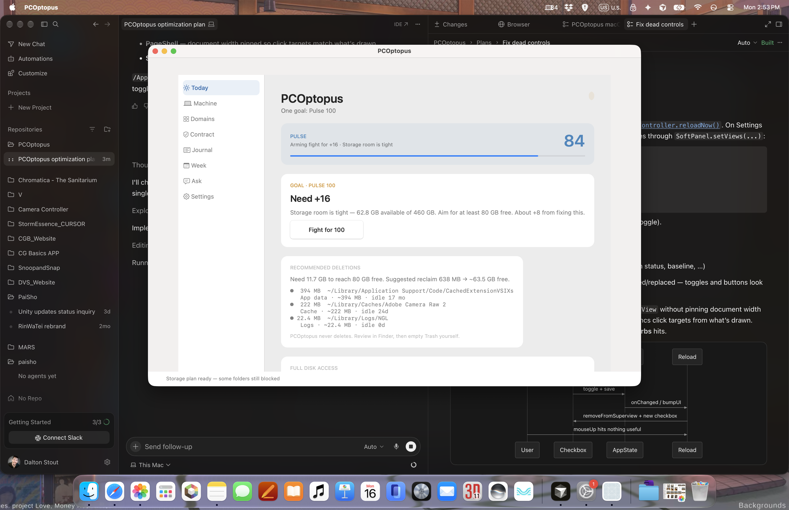

# PCOptopus

**Native macOS performance coach for Apple Silicon.** One goal: keep **Pulse at 100**.

PCOptopus watches this Mac in real time, explains what’s dragging health in plain language, and applies only **reversible** tweaks you grant. Storage cleanup is recommend-only — it never deletes for you.



## Why it exists

Most “optimizers” either scare you or silently change the machine. PCOptopus is built like production systems work:

- **Sensors** read live metrics (power, memory, storage, agents, Homebrew path)
- **Policy** turns findings into decisions with cooldowns and a kill switch
- **Contract** is an empty-by-default grant list — nothing changes until allowed
- **Journal** write-ahead logs every change with **Undo**
- **Pulse** is a single health score the UI and autopilot fight to hold at 100

## Quick start

Requires macOS 14+ and Swift 6 (Command Line Tools or Xcode).

```bash
git clone <your-fork-or-repo-url>
cd PCOptopus
swift run PCOptopusVerification   # zero-write safety + policy checks
./Scripts/package-app.sh          # build → dist/ + /Applications/PCOptopus.app
open /Applications/PCOptopus.app
```

Then: **System Settings → Privacy & Security → Full Disk Access → enable PCOptopus** (once). Rebuilds keep the grant when signed with the local signing identity from `Scripts/ensure-signing-identity.sh`.

## Architecture

```text
App (AppKit)
  └─ PCOptopusKit
       Model · Sensors · Policy · Apply · Store · Coach
Helper (allowlisted pmset / launchctl)
Verification (CLI harness — CI entry point)
```

| Path | Role |
|------|------|
| [`App/Sources`](App/Sources) | AppKit menu-bar + window UI (ships today) |
| [`Packages/PCOptopusKit`](Packages/PCOptopusKit) | Domain logic: Pulse, rules, journal, SQLite |
| [`Helper/Sources`](Helper/Sources) | Privileged CLI — allowlisted power settings only |
| [`Scripts/package-app.sh`](Scripts/package-app.sh) | Build, sign, install to `/Applications` |
| [`docs/SAFETY.md`](docs/SAFETY.md) | Hard bans, grant model, journal rules |
| [`docs/DESIGN.md`](docs/DESIGN.md) | Portfolio / interview design write-up |

`App/SwiftUI/` holds alternate screens for a full Xcode toolchain; the shipping binary is AppKit so it builds with Command Line Tools alone.

## Safety (non-negotiable)

- Empty contract ⇒ **zero writes**
- Kill switch stops the tick and helper path
- No automatic deletion, no SIP / firmware / Mail / Photos access
- Confirm-tier (PATH, some power) is explicit; manual-tier is recommend-only

Full rules: [docs/SAFETY.md](docs/SAFETY.md).

## Verify

```bash
swift run PCOptopusVerification
```

CI runs the same harness on every push (see [`.github/workflows/verify.yml`](.github/workflows/verify.yml)).

## Demo script (≈90 seconds)

1. Open Today — Pulse below 100, subtitle **One goal: Pulse 100**
2. Tap **Fight for 100** — grants/applies safe fixes; storage scan lists reclaim candidates
3. Open **Journal** — show before/after and **Undo**
4. Open **Contract** / **Settings** — empty-by-default grants, kill switch
5. Close on: “Nothing deletes without you; everything applied is reversible.”

## Out of scope (v1)

Windows, App Store sandbox, automatic deletion, Homebrew bottle migration, cloud LLMs, SIP / hibernatemode / firmware.

## License

Personal / portfolio project. Add a license before publishing if you want others to reuse the code.
